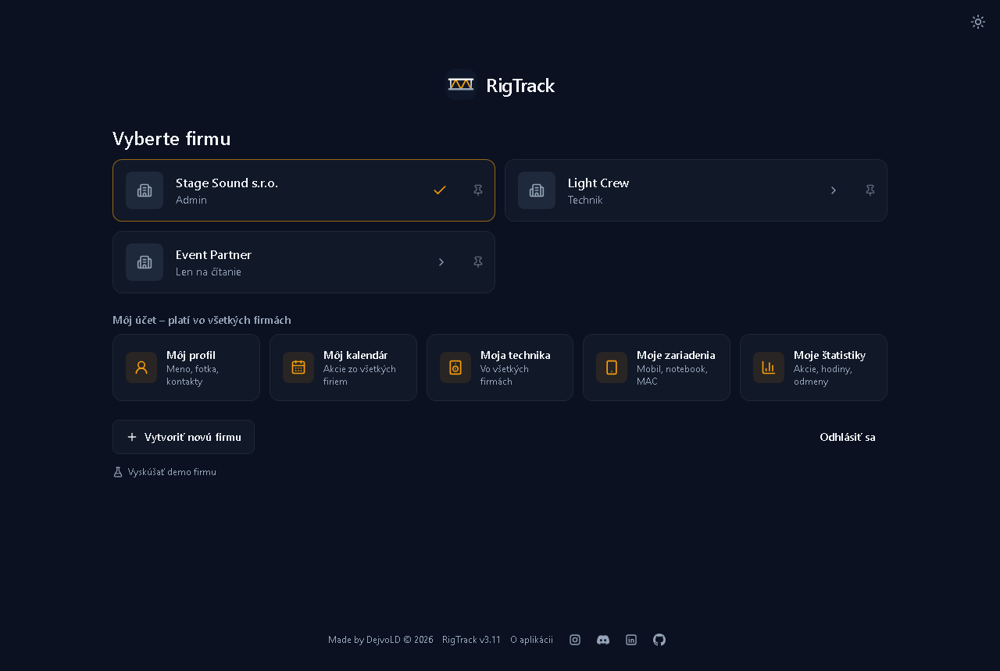
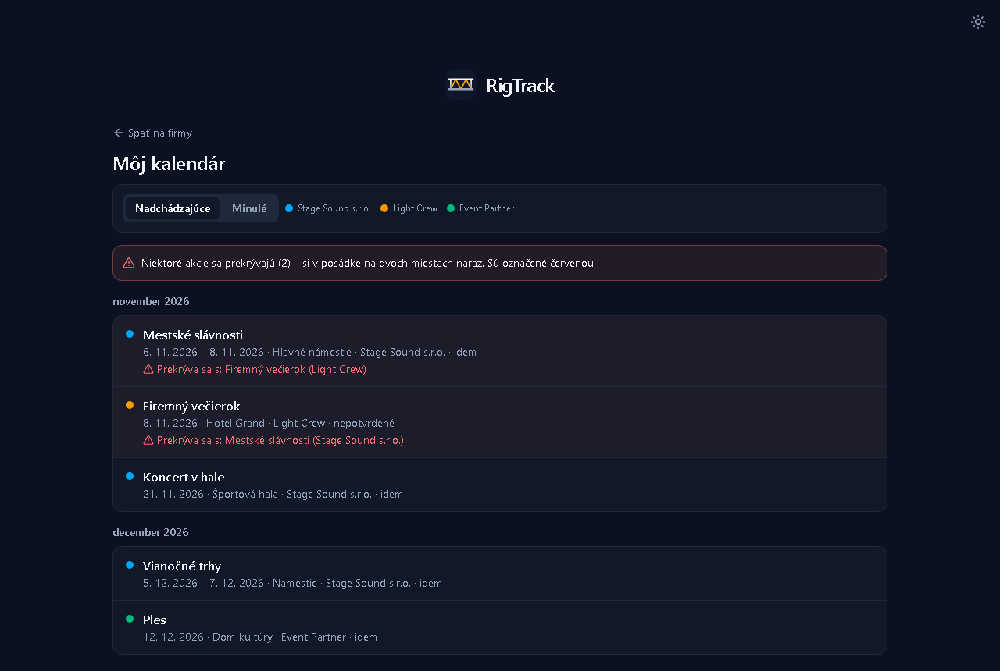
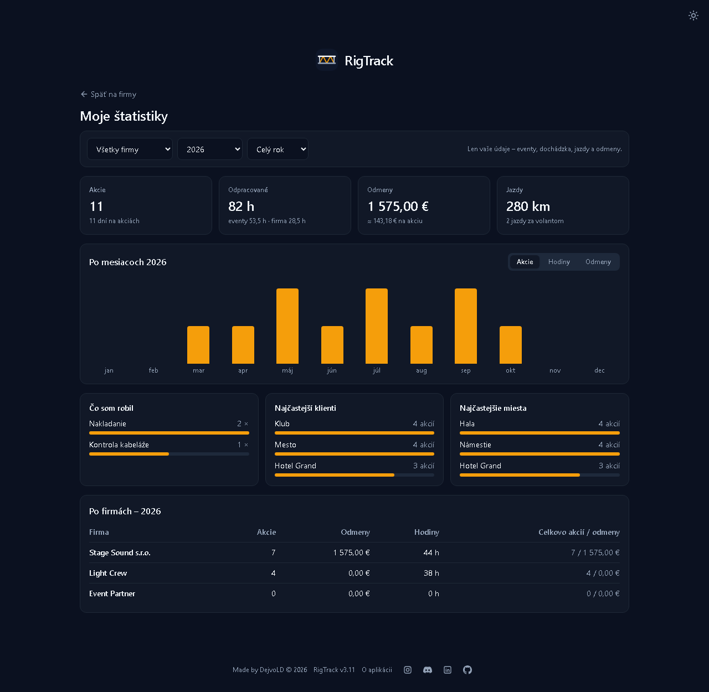
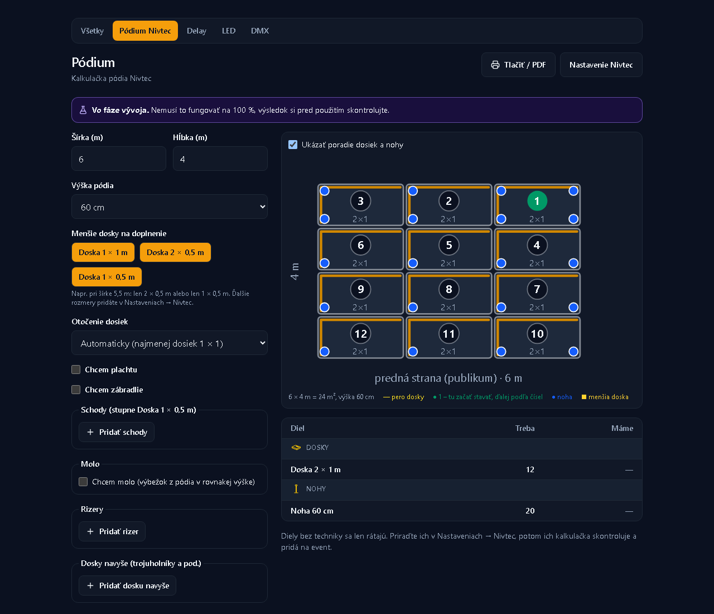
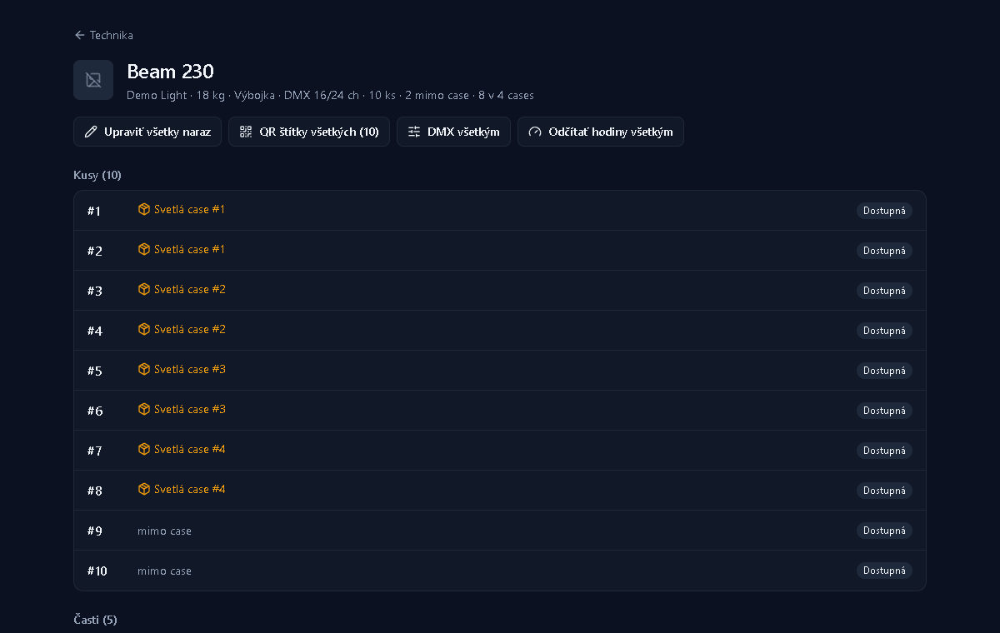
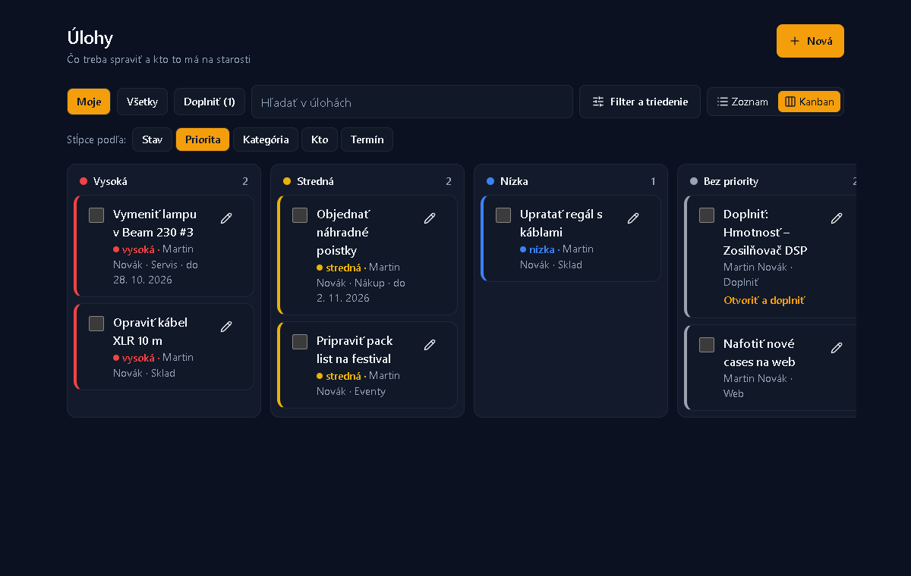
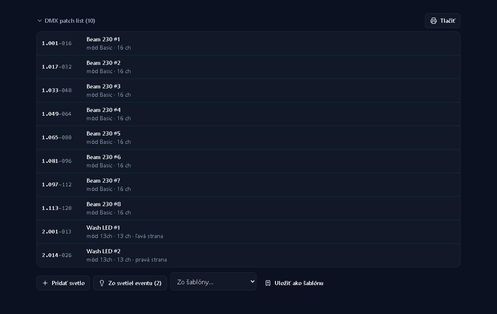
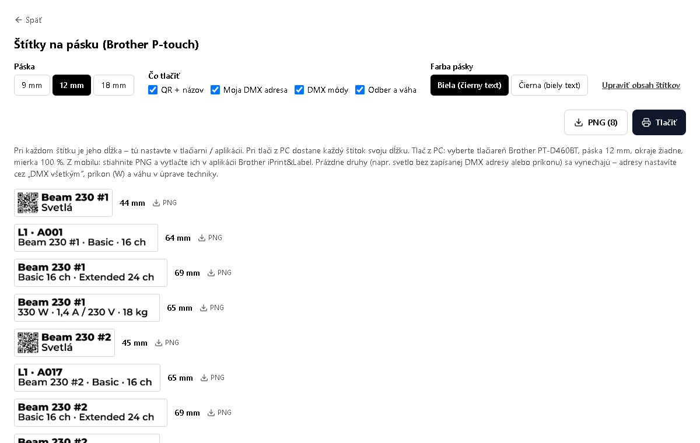

<div align="center">


# RigTrack

**Technika, cases, eventy a ľudia pre event a AV firmy – na jednom mieste.**


### 🔗 [Otvoriť RigTrack → davidbabjarcik.github.io/RigTrack](https://davidbabjarcik.github.io/RigTrack)

[Čo je nové](CHANGELOG.md) · [Funkcie](#moduly) · [Spustenie](#spustenie) · [Pre vývojárov](#pre-vývojárov)

</div>

RigTrack je webová aplikácia, ktorá drží na jednom mieste všetko, čo sa v požičovni a na akciách deje:
technika a jej kusy, cases a sklad, výpožičky, eventy s posádkou a pack listom, servis, vozidlá, nákupy
aj interná agenda firmy. Beží v prehliadači na počítači aj na mobile, dá sa pridať na plochu ako aplikácia
a jeden účet obslúži viac firiem – každá vidí len svoje dáta.

<table>
  <tr>
    <td width="50%"><br /><sub><b>Vyberte firmu</b> – firmy a môj účet naprieč firmami</sub></td>
    <td width="50%"><br /><sub><b>Môj kalendár</b> – akcie zo všetkých firiem a kolízie</sub></td>
  </tr>
  <tr>
    <td><br /><sub><b>Moje štatistiky</b> – akcie, hodiny, odmeny, jazdy</sub></td>
    <td><br /><sub><b>Pódium Nivtec</b> – dosky, nohy a poradie stavania</sub></td>
  </tr>
  <tr>
    <td><br /><sub><b>Technika po kusoch</b> – kde je ktorý kus, úprava, DMX a hodiny všetkým naraz</sub></td>
    <td><br /><sub><b>Úlohy</b> – kanban podľa priority, stavu, kategórie či človeka</sub></td>
  </tr>
  <tr>
    <td><br /><sub><b>DMX patch list</b> – zo svetiel eventu, kontrola adries, tlač</sub></td>
    <td><br /><sub><b>Štítky na pásku</b> – Brother P-touch: QR, DMX adresa, módy, odber</sub></td>
  </tr>
</table>

<sub>Snímky sú z ukážkových (vymyslených) údajov.</sub>

## ✨ Najnovšie

| Verzia | Čo pribudlo |
|---|---|
| **5.2** | Verzia softvéru pri mixpulte, kategória len keď sa používa, vysvetlenie čiernej pásky |
| **5.1** | Farby druhov techniky, fotky na hárku case bez bieleho pozadia |
| **5.0** | Príslušenstvo pri akejkoľvek technike v case, väčšie vycentrované karty, hárok aj na A5 |
| **4.20** | Variant kábla (stereo, silent…) – na hárku v stĺpci typu s rozpisom |

Celý zoznam zmien je v **[CHANGELOG.md](CHANGELOG.md)** (a v appke v „Čo je nové“).

| | |
|---|---|
| **Frontend** | React · TypeScript · Vite · Tailwind CSS · React Router · TanStack Query |
| **Backend** | Supabase – prihlásenie, Postgres s Row Level Security, úložisko súborov, Edge Functions |
| **Ďalej** | `vite-plugin-pwa` (offline inštalácia, push), `pdfjs-dist`, `read-excel-file` / `write-excel-file` |

---

## Moduly

Kliknutím na modul sa rozbalí, čo všetko vie.

<details>
<summary><b>🎛️ Technika</b></summary>

- Zariadenia, káble, svetlá, zvuk, hliník/truss, pódium a spotrebný materiál – každý druh má vlastné polia
  (dĺžka a konektor kábla, výkon a zdroj svetla, **DMX módy**, typ zvuku, dĺžka trussu…).
- Výrobca, model, sériové a inventárne číslo, MAC a IP; fotky aj cez Ctrl+V, náhľady v zoznamoch.
- **Farebný prúžok** podľa kategórie (svetlá zelené, zvuk ružový, pódium žlté, truss červený) – nastaviteľný.
- **Evidencia po kusoch** (#1, #2… alebo vlastné čísla 1, 4, 8) s vlastnou históriou každého kusu;
  háky, káble či viazačky sa rátajú len na počet.
- Servisné intervaly a odčítanie prevádzkových hodín s pripomienkami, hranica „treba dokúpiť“.
- Sada káblov naraz podľa dĺžok s farebným značením, cenník prenájmu za deň.
- **Siete** – Wi-Fi siete s heslom, QR kódom, routerom a DHCP; všetky IP / MAC adresy techniky aj zariadení členov.
- **Rozmery boxu** reproboxov a subov (pre delay kalkulačku).
- **Excel** – export a import techniky aj cases (hárok na kategóriu, hárok „Cases“, prázdna šablóna).
- Pri každej technike história nákupov, servisu, výpožičiek a eventov.

</details>

<details>
<summary><b>📦 Cases a sklad</b></summary>

- Obsah, hmotnosť, rozmery, umiestnenie, fotka a kontroly obsahu (kto a kedy).
- **Šablóny cases** – rozmery sa zadajú raz, nové cases (aj viac naraz) vzniknú výberom šablóny.
- **Flight case štítok** (PNG) a hárok **FLIGHTCASE CONTENT** (A4) s farbami dĺžok káblov.
- **Plán skladu** *(vo vývoji)* – regály, palety a zóny zhora, kde ktorý case leží.

</details>

<details>
<summary><b>🔁 Výpožičky</b></summary>

- Rezervácia → vydanie → vrátenie; kolízie termínov (aj s eventmi) stráži databáza.
- Výber celých cases alebo jednotlivých kusov, pri technike po kusoch konkrétne čísla.
- Ceny z cenníka, účtované dni, dohodnutá cena, kaucia, IČO a adresa.
- Pri vrátení sa označia poškodenia; poškodeným kusom sa otvorí servisný záznam.
- **Zapožičacia listina** na tlač / PDF s dátumami, menami a poškodeniami.

</details>

<details>
<summary><b>🎪 Eventy</b></summary>

- Technika (aj celé cases), posádka, fotky a dokumenty (rider, stage plot…), kolízie s inými akciami.
- Organizátor s kontaktom, popis, časy príchodu a programu.
- **Interiér / exteriér a elektrina** (napr. CEE 32 A päťpól, počet prípojok), pri akcii vonku **predpoveď počasia**
  s upozornením na dážď, búrku a vietor.
- **Tlač eventu** na A4 / PDF – technika ako checklist, obsah case malým sivým písmom.
- **Príjmy z akcie** – hotovosť, na účet alebo faktúra (cez vlastnú alebo partnerskú firmu), s DPH / bez DPH.
- **Import z Capture** – Equipment Report sa spáruje s technikou, neznáme veci treba rozhodnúť,
  zapíše sa až po kontrole; priradenia si appka pamätá.
- Upozornenie na case, ktorý od poslednej kontroly obsahu bol na eventoch.
- **Opakované akcie** – návrh údajov, posádky a odmien z minulého ročníka.
- **Viacdňový program** (stavba / event / balenie, kto ide v ktorý deň), **organizátor a firmy** s kontaktmi,
  **odkazy** (rider, lightplot…), **doprava a km zo skladu** a **osobný výkaz** času a výdavkov.
- **Balíky** – vopred poskladané sady (malý / veľký zvukový, svetelný…) sa na event aj do výpožičky pridajú jedným klikom.
- **Pripomienky** – podľa pravidiel z nastavení upozorní pri evente aj výpožičke, čo k technike ešte chýba
  (napr. 4 repráky → 4 káble NL4, svetlá → case s hákmi).
- **Plán nakladania** *(vo vývoji)* – koľko vozidiel treba a kam ktorý case uložiť, zhora aj v 3D.
- **Pódium Nivtec** *(vo vývoji)* – z rozmerov a výšky spočíta dosky (aj 1 × 0,5 m a trojuholníky),
  nohy (susedné dosky sa delia o nohu – sedí s papierovou tabuľkou), schody po 20 cm, lišty na pero /
  drážku (každá na jednu dosku), plachty so štipcami, zábradlie s otvormi pre schody, výstuhy od 80 cm,
  **molo**, **rizery** (pevné alebo na kolieskach)
  a príslušenstvo; nakreslí pôdorys (pero vzadu a vpravo), porovná so skladom a pridá diely na event.
- **Delay kalkulačka** – topy ↔ suby, delay veža, cardioid, end-fire, rovný rad a arc delay s nákresom a odhadom
  smerovosti; počíta s teplotou a rozmermi subu.
- **Do kalendára** (.ics / Google) a **do kontaktov** (.vcf) pri evente aj výpožičke; sekcie sa dajú zbaliť.

</details>

<details>
<summary><b>🔧 Servis a 🚐 vozidlá</b></summary>

- Opravy, kontroly a údržba s prílohami, časom a nákladmi; do servisu môže ísť len časť kusov.
- **Servisní technici** – adresár servisov pre techniku a autá, stály servis auta, uloženie do kontaktov.
- STK, EK, diaľničná známka, poistky a leasing s pripomienkami; tankovanie, servis, spotreba, fotka.
- **Nákladný priestor** – nosnosť, rozmery a prekážky (podbehy), aj v grafickom editore.

</details>

<details>
<summary><b>🛒 Objednávky a nákupy</b></summary>

- Nákupy s položkami, z ktorých vzniká technika; **import faktúr z Thomannu** (PDF v prehliadači).
- **Nákupy z bazárov** (Bazoš, Hudebnibazar, Kleinanzeigen, Willhaben, eBay, Reverb…) s predajcom.
- Fotka nákupu; zoznamy „kúpiť“ a „chceme časom“ s fotkami.

</details>

<details>
<summary><b>👥 Firma a ľudia</b></summary>

- **Zamestnanci** – tím s fotkou, pozíciou, kontaktom a zručnosťami, kto kedy nemôže a na ktorých eventoch je;
  upozornenie v posádke eventu, keď niekto v termíne nemôže.
- **Odmeny** – odmeny a zálohy členov, filter podľa rokov, koláčový graf; člen vidí len svoje.
- **Úlohy, Návrhy, Kalendár** (zoznam aj mesačná mriežka, export do .ics), **Upozornenia**, **História zmien**.
- **Štatistiky** (čo vidieť aj v akom poradí si nastaví každý sám) – technika, servis, vozidlá a **peniaze**: príjmy firmy, odmeny a zostatok (s oprávnením)
  a každému jeho vlastné zárobky podľa role, mesiacov a rokov, s koláčovými grafmi.
- **Záloha** – admin stiahne celú firmu ako ZIP s Excelmi (fotky a dokumenty v nej nie sú).
- **Hlásenia chýb** – ktokoľvek nahlási chybu (aj so screenshotom), admin a vývojár ju riešia; upozornenie v appke aj e-mailom.
- **Kôš** – zmazané veci sa dajú 30 dní obnoviť (`/admin/recycle-bin`, iba admin); kôš aj história zmien sa dajú exportovať do Excelu.

</details>

<details>
<summary><b>⚙️ Nastavenia</b></summary>

- Členovia a pozvánky, roly admin / skladník / technik / len na čítanie.
- **Oprávnenia** pre každú rolu aj výnimky pre jednotlivých členov.
- Logo firmy (pozadie sa odstráni, logo sa prispôsobí svetlému aj tmavému podkladu), kategórie s farbami,
  umiestnenia, šablóny cases, záložky **Nivtec**, **Balíky** a **Pripomienky**.
- Svetlý / tmavý režim, **demo firma** s resetom, verzia aplikácie a **Čo je nové**.
- Roly admin, **CEO**, skladník, technik, len na čítanie; **registrácia len na pozvánku**; stav účtov pri členoch.
- **Moje zariadenia** (MAC adresy) a **zmazanie firmy** so všetkými údajmi a súbormi.

</details>

---

## Bezpečnosť

Oddelenie firiem a všetky oprávnenia stráži databáza (Row Level Security v Supabase); aplikácia
len skrýva ovládanie, ktoré by aj tak neprešlo. Admin má vždy všetko, aby sa firma nemohla zamknúť.
Tajný (service-role) kľúč Supabase do aplikácie nepatrí – používa sa len verejný publishable kľúč.

## Obmedzenia

- Bez internetu nefunguje – dáta sa čítajú aj zapisujú priamo do databázy.
- Upozornenia na mobil (push) a pripomienky podľa času treba raz nastaviť v Supabase (sprievodca je v Nastaveniach).
- Kôš sa po 30 dňoch vyčistí, až keď aplikáciu otvorí admin.
- **Plán nakladania, plán skladu, pódium Nivtec a kalkulačky Delay a LED sú vo fáze vývoja** a nemusia fungovať na 100 % –
  výsledok treba skontrolovať.
- Import techniky na event pozná zatiaľ len Equipment Report z Capture.
- Počasie poskytuje Open-Meteo (open-meteo.com); posiela sa mu len názov miesta a dátumy akcie.
- Km z mapy rátajú OpenStreetMap Nominatim (adresa → poloha) a OSRM (trasa); posiela sa len adresa skladu a akcie.
- Fotky a dokumenty sú v úložisku Supabase (v databáze je len cesta k nim); presun na vlastný NAS zatiaľ nie je.

---

## Spustenie

```bash
npm install
npm run dev
```

Aplikácia beží na `http://localhost:5173`. Bez databázy sa zobrazí iba kostra bez prihlásenia.

<details>
<summary><b>Pripojenie Supabase</b></summary>

1. Vytvor projekt na supabase.com.
2. **Nová inštalácia:** v SQL Editore spusti `supabase/baseline.sql` – celá databáza naraz (stav po migrácii `0058`).
   Potom spusti zo `supabase/migrations/` už len súbory s číslom **vyšším ako 0058** (ak nejaké sú).
   **Existujúca databáza:** spusti v SQL Editore `supabase/check-migrations.sql` – ukáže, ktoré migrácie chýbajú.
   Doplň ich podľa čísla od najnižšej: `0020`–`0048` sú v `supabase/upgrade/`, `0049` a vyššie v
   `supabase/migrations/` (`0053` samostatne pred `0054`). Pri ďalších aktualizáciách spúšťaj len nové –
   ktoré to sú, je v [CHANGELOG.md](CHANGELOG.md).
   **Najjednoduchšie:** `supabase/update-all.sql` obsahuje všetky migrácie od `0086` po najnovšiu a opravné
   `0071` a `0072` v jednom súbore – vlož ho celý do SQL Editora a spusti (dá sa spustiť aj opakovane).
   Vývojár ho po pridaní migrácie pregeneruje príkazom `npm run db:update`.
3. V Authentication → URL Configuration nastav Site URL (`http://localhost:5173`, neskôr produkčnú doménu)
   a medzi Redirect URLs pridaj `<adresa>/auth/update-password`.
4. Potvrdzovanie e-mailu (Authentication → Sign In / Providers → Email → Confirm email) nechaj **zapnuté** –
   pozvánky do firmy sa viažu na potvrdenú adresu.
5. Skopíruj `.env.example` do `.env.local` a doplň Project URL a publishable kľúč.

</details>

<details>
<summary><b>Registrácia len na pozvánku</b></summary>

Po migrácii `0056` zapni v Supabase **Authentication → Hooks → Before User Created → Postgres function →
`public.hook_require_invitation`**. Potom si účet vytvorí len e-mail, ktorý má pozvánku do niektorej firmy
(admin ju pridá v Nastaveniach → Členovia). Bez zapnutého hooku sa môže zaregistrovať ktokoľvek, len bez
pozvánky neuvidí žiadnu firmu.

</details>

<details>
<summary><b>Nahlasovanie chýb – e-maily</b></summary>

Hlásenia fungujú v aplikácii hneď po migrácii `0048`. Aby chodili aj e-mailom:

1. **Označ seba ako vývojára** (v SQL Editore, raz):
   `insert into public.app_developers (user_id) select id from auth.users where email = 'tvoj@email';`
2. **Resend** (resend.com, do 3 000 e-mailov mesačne zadarmo): založ účet, over doménu odosielateľa
   (bez overenej domény ide z `onboarding@resend.dev` len na tvoj vlastný e-mail) a vytvor API kľúč.
3. **Nasaď funkciu** cez Supabase CLI z koreňa repozitára:
   ```bash
   npx supabase login
   npx supabase link --project-ref <ref-projektu>
   npx supabase functions deploy notify-bug-report
   npx supabase functions deploy notify-new-event
   npx supabase secrets set RESEND_API_KEY=re_... BUG_REPORT_FROM="RigTrack <chyby@tvoja-domena.sk>" APP_URL=https://<používateľ>.github.io/RigTrack
   ```
E-mail dostanú vývojári a admini firmy, v ktorej bola chyba nahlásená. Kým funkcia nie je nasadená,
hlásenia sa len uložia a ukážu v aplikácii.

</details>

<details>
<summary><b>Push upozornenia na mobil – nastavenie</b></summary>

Najjednoduchšie cez sprievodcu v appke: **Výber firmy → Vývojár → Push upozornenia – nastavenie** (vidí ho vývojár zapísaný v `app_developers`).
Príkazový riadok ani Database Webhook netreba. Predtým spusti migrácie `0084` a `0088`.

1. **Vygeneruj kľúče** tlačidlom v sprievodcovi (vzniknú v prehliadači, nikam sa neukladajú).
2. **Ulož ich** v Supabase → Edge Functions → Secrets: `VAPID_PUBLIC_KEY`, `VAPID_PRIVATE_KEY`, `VAPID_SUBJECT`
   (mailto:…), `PUSH_WEBHOOK_SECRET` – len tam, nikdy nie do kódu, `.env` ani do chatu.
3. **Nasaď funkciu**: Edge Functions → Deploy a new function → Via Editor, názov `send-push`, vlož kód
   (tlačidlo „Kopírovať kód funkcie“; je to `supabase/functions/send-push/index.ts`) → Deploy. V nastaveniach
   funkcie vypni **Verify JWT**.
4. **Prepoj databázu**: v SQL Editore spusti SQL zo sprievodcu – uloží adresu funkcie a tajomstvo do Vault.
   Databáza potom pri každom upozornení zavolá funkciu sama (`pg_net`). Ak máš z minula Database Webhook pre
   `notifications`, zmaž ho, inak príde upozornenie dvakrát.
5. **Skontroluj** tlačidlom v sprievodcovi; keď je všetko zelené, každý si upozornenia zapne v
   **Nastavenia → Účet → Upozornenia na mobil** (na iPhone len z appky pridanej na plochu, iOS 16.4+)
   a tlačidlom „Poslať skúšobné“ overí, že chodia.

S príkazovým riadkom to ide aj postaru: `npx web-push generate-vapid-keys`,
`npx supabase secrets set …` a `npx supabase functions deploy send-push --no-verify-jwt`; krok 4 je rovnaký.

</details>

<details>
<summary><b>Nasadenie na GitHub Pages</b></summary>

Najjednoduchšie: bez servera, HTTPS zabezpečí GitHub. Workflow `.github/workflows/pages.yml` pri každom
pushe do `main` spustí testy, zbuilduje appku a nasadí ju.

1. V repozitári: **Settings → Pages → Source: GitHub Actions**.
2. **Settings → Secrets and variables → Actions → Variables** – pridaj `VITE_SUPABASE_URL`
   a `VITE_SUPABASE_PUBLISHABLE_KEY` (verejný kľúč; service-role sem nikdy).
3. V Supabase → Authentication → URL Configuration pridaj `https://<používateľ>.github.io/RigTrack/`
   do Site URL (alebo Redirect URLs) a `https://<používateľ>.github.io/RigTrack/auth/update-password` do Redirect URLs.
4. Spusti workflow (push do `main` alebo Actions → GitHub Pages → Run workflow).

Appka beží v podpriečinku `/RigTrack/` (nastavuje ho premenná `BASE_PATH` pri builde). GitHub Pages zo
súkromného repozitára vyžaduje platený plán GitHubu.

</details>

<details>
<summary><b>Nasadenie na vlastný server</b></summary>

Docker + Cloudflare Tunnel: netreba otvárať porty na routeri ani riešiť certifikát, HTTPS zabezpečí Cloudflare.

**Hotový balík na NAS (odporúčané)**

1. `npm run package` vytvorí priečinok `release/`.
2. Skopíruj `release/` na NAS a spusti v ňom `docker compose up -d`. Aplikácia beží na porte 8080.
3. V existujúcom Cloudflare tuneli pridaj Public Hostname `rigtrack.jef-sp.sk` so službou `http://IP-NAS:8080`.

Aktualizácia: znova `npm run package` a prepíš na NAS priečinok `release/dist`.

**Zostavenie priamo na serveri**

Naklonuj repozitár, skopíruj `.env.example` do `.env` a spusti `docker compose up -d --build`.
Ak ešte nemáš tunel, doplň `TUNNEL_TOKEN` a pridaj `--profile tunnel`; služba v tuneli je potom `http://web:80`.

</details>

---

## Pre vývojárov

| Príkaz | Čo robí |
|---|---|
| `npm run dev` | vývojový server |
| `npm run build` | kontrola typov a produkčný build (vrátane service workera) |
| `npm run preview` | náhľad produkčného buildu, skúška inštalácie PWA |
| `npm run package` | balík `release/` na nasadenie |
| `npm run lint` | ESLint |
| `npm test` | testy (Vitest) vrátane testov databázy v PGlite |

- `src/features/<modul>/` – každý modul má `model.ts` (pravidlá a výpočty s testami), `api.ts` (dotazy) a obrazovky.
- `src/lib/`, `src/components/` – navigácia, oprávnenia, formátovanie, prvky rozhrania, verzia, ZIP.
- `supabase/baseline.sql` – celá schéma a pravidlá prístupu naraz (stav po `0058`); `supabase/migrations/` – novšie
  zmeny (a `0049`–`0058` pre staršie inštalácie); `supabase/tests/` – testy (bežia v pamäti, bez Supabase).
- Verzia sa berie z `package.json`; pri novej verzii sa zvýši tam a pribudne záznam v [CHANGELOG.md](CHANGELOG.md) a riadok v tabuľke „Najnovšie“ v README.

---

Made by **DejvoLD** © 2026
