<div align="center">


# RigTrack

**Sklad, akcie a podklady pre zvukové a svetelné firmy.**


[Otvoriť RigTrack](https://davidbabjarcik.github.io/RigTrack) · [Čo je nové](CHANGELOG.md) · [Čo vie](#čo-vie) · [Spustenie](#spustenie) · [Pre vývojárov](#pre-vývojárov)

</div>

RigTrack je webová aplikácia pre požičovne a firmy, ktoré robia zvuk, svetlo a pódiá. Eviduje techniku po kusoch,
cases a sklad, plánuje akcie s posádkou a pack listom a pripraví podklady, ktoré sa posielajú zvukárom a klubom:
input list, stage plán, synoptiku, HF plán, site plán a harmonogram. Beží v prehliadači na počítači aj na mobile,
dá sa pridať na plochu a jeden účet obslúži viac firiem – každá vidí len svoje dáta.

## Ako to vyzerá

<table>
  <tr>
    <td width="50%">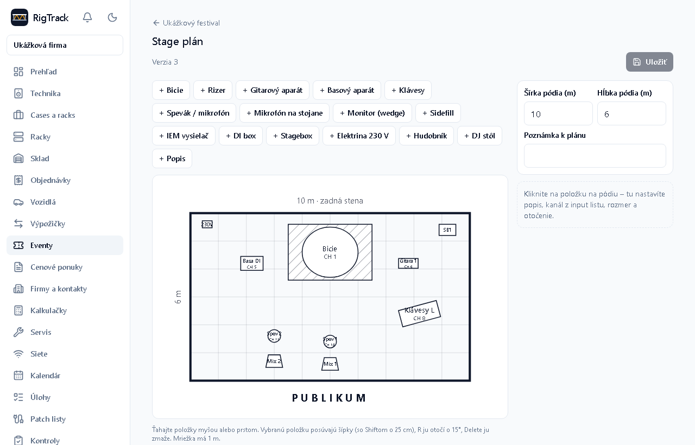<br /><sub><b>Stage plán</b> – pódium v mierke s kanálmi z input listu</sub></td>
    <td width="50%">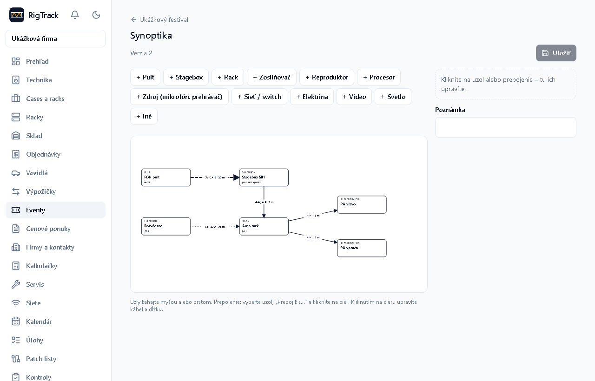<br /><sub><b>Synoptika</b> – zapojenie signálu, káble a dĺžky</sub></td>
  </tr>
  <tr>
    <td>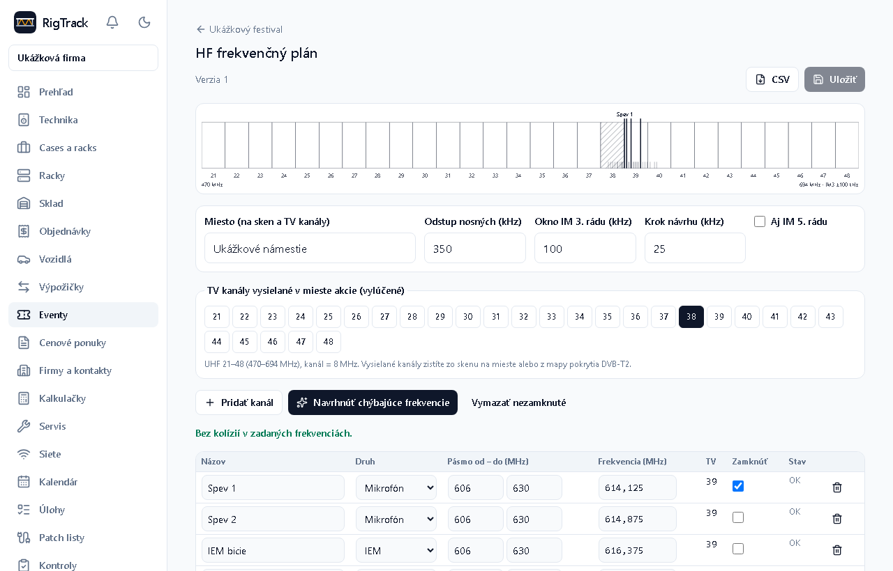<br /><sub><b>HF plán</b> – intermodulácie, TV kanály a návrh frekvencií</sub></td>
    <td><br /><sub><b>DMX patch list</b> – zo svetiel akcie, s kontrolou adries</sub></td>
  </tr>
  <tr>
    <td><br /><sub><b>Plán skladu</b> – regály, palety, hliník a miestnosti</sub></td>
    <td><br /><sub><b>Regál spredu</b> – police, palety a cases na nich</sub></td>
  </tr>
  <tr>
    <td><br /><sub><b>Hliník v sklade</b> – stohy trussov zhora aj spredu</sub></td>
    <td>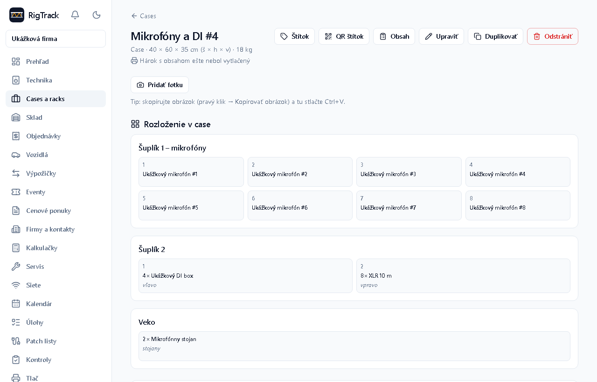<br /><sub><b>Rozloženie v case</b> – šuplíky a priehradky</sub></td>
  </tr>
  <tr>
    <td>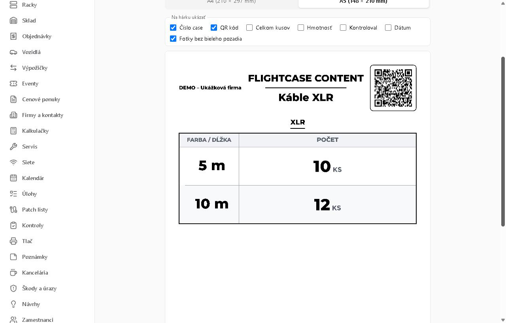<br /><sub><b>Obsah case</b> – káble podľa dĺžky a farby, QR kód</sub></td>
    <td>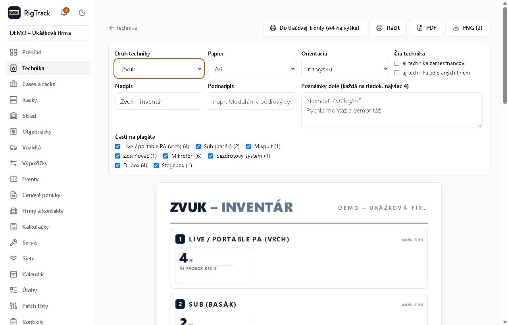<br /><sub><b>Plagát inventára</b> – na tlač, do PDF aj PNG</sub></td>
  </tr>
  <tr>
    <td>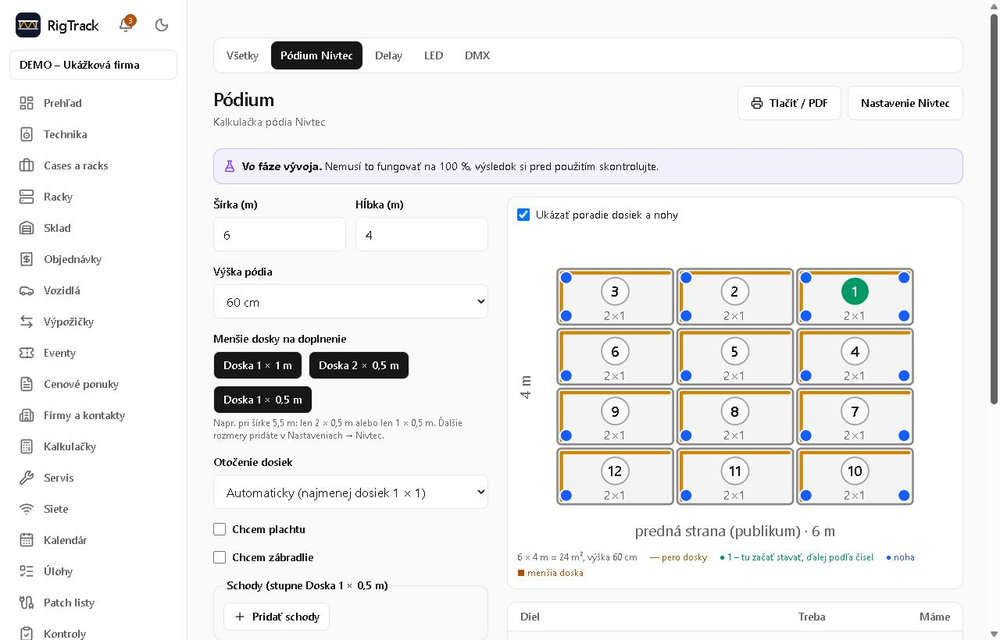<br /><sub><b>Pódium Nivtec</b> – dosky, nohy a poradie stavania</sub></td>
    <td>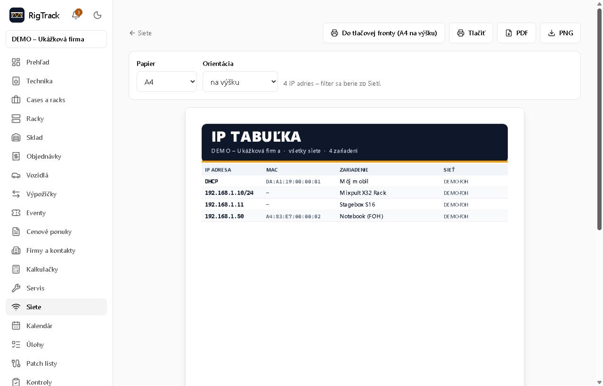<br /><sub><b>IP tabuľka</b> – zariadenia v sieti, tlač A4 / A5</sub></td>
  </tr>
  <tr>
    <td>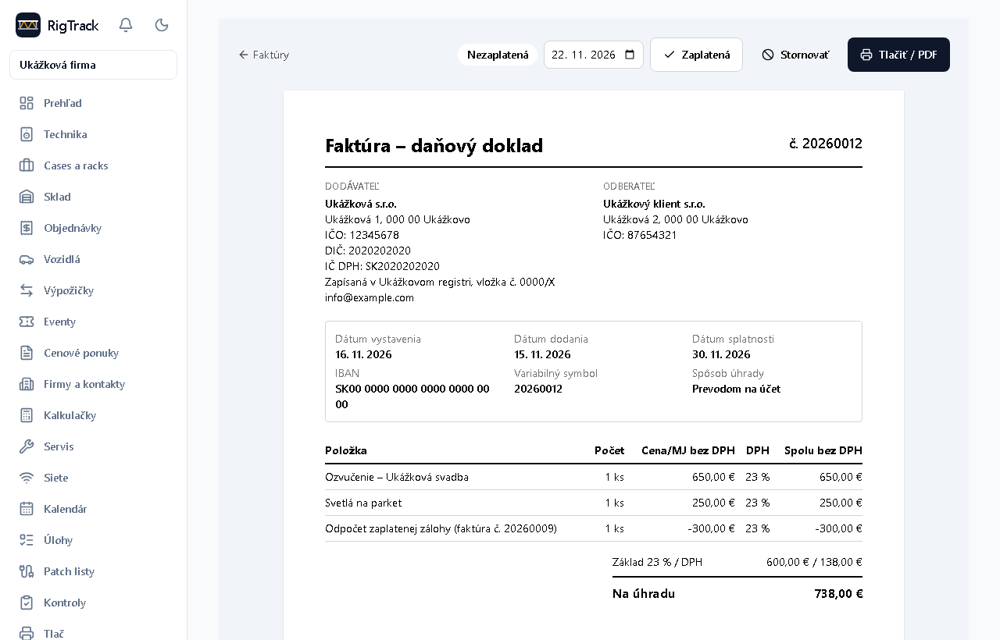<br /><sub><b>Faktúry</b> – zálohová a konečná z cenovej ponuky</sub></td>
    <td>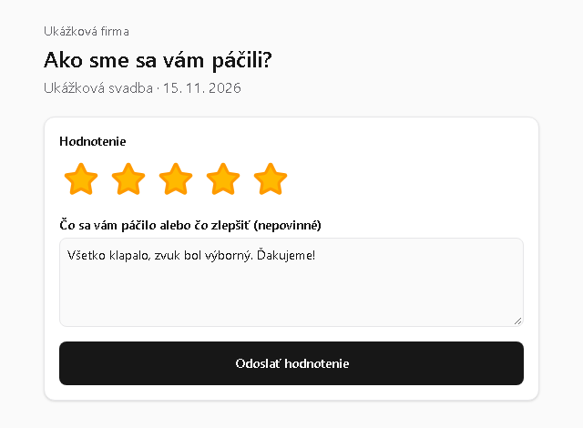<br /><sub><b>Hodnotenie</b> – klient ohodnotí akciu cez odkaz</sub></td>
  </tr>
  <tr>
    <td>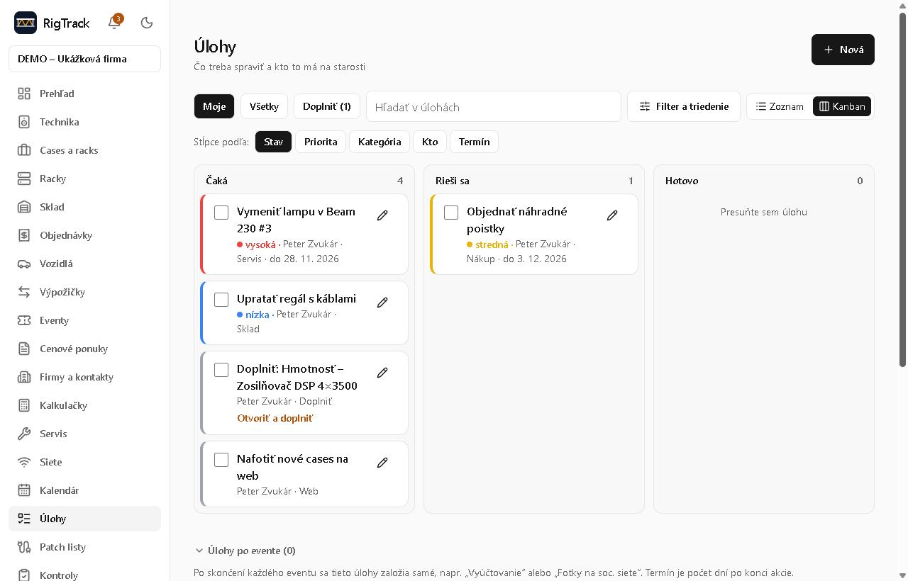<br /><sub><b>Úlohy</b> – kanban podľa priority, stavu či človeka</sub></td>
    <td><br /><sub><b>Kalendár</b> – akcie zo všetkých firiem a kolízie</sub></td>
  </tr>
</table>

<sub>Snímky sú z ukážkovej firmy s vymyslenými údajmi.</sub>

## Najnovšie

| Verzia | Čo pribudlo |
|---|---|
| **12.12** | Knižnica prístrojov v editore racku – kategórie, výrobca, môj materiál a databáza |
| **12.11** | Súhrn racku – prístroje, U, hmotnosť a prúd pri 230 V |
| **12.10.3** | Cases a racky na jednej stránke |
| **12.10.2** | Cases a racky v jednej položke menu |
| **12.10.1** | 2FA v autentifikátore pod názvom RigTrack |
| **12.10** | Zobraziť heslo, nová úvodná stránka, README a snímky |
| **12.9** | Pokojnejší vzhľad – grafitové farby, písmo a úvodná stránka |
| **12.8.5** | Bez falošnej chyby pri obnove na novú verziu |
| **12.8.4** | Káble kúpené hotové, minimum len pri spotrebnom materiáli, obnovenie upozornenia po fotke |
| **12.8.3** | Polia pre rack len pri technike do racku |

Celý zoznam zmien je v [CHANGELOG.md](CHANGELOG.md) a v aplikácii v „Čo je nové“.

---

## Čo vie

### Technika

- Zariadenia, káble, svetlá, zvuk, truss, pódium a spotrebný materiál – každý druh má vlastné polia
  (dĺžka a konektor kábla, DMX módy svetla, rozmery boxu, U a hĺbka pre rack…).
- Výrobca zo zoznamu značiek, model, sériové a inventárne číslo, MAC a IP, Thomann číslo s odkazom; fotky aj cez Ctrl+V.
- Evidencia po kusoch (#1, #2… alebo vlastné čísla) s históriou každého kusu; drobnosti sa rátajú len na počet.
- Farebný prúžok podľa kategórie, servisné intervaly a prevádzkové hodiny, hranica pre spotrebný materiál.
- Sada káblov naraz podľa dĺžok s farbami, kto káble vyrobil alebo či sú kúpené hotové.
- História nákupov, servisu, výpožičiek a akcií, návratnosť, predaná technika pre účtovníka.
- Siete – Wi-Fi s QR kódom, IP a MAC adresy techniky, tlač IP tabuľky.
- Programy a licencie, export a import do Excelu, plagát inventára.

### Cases a sklad

- Obsah, hmotnosť, rozmery, umiestnenie a kontroly obsahu po položkách (kto a kedy).
- Šablóny cases, štítok case a hárok s obsahom (aj podľa rozloženia, s fotkami), tlač naraz ako ZIP.
- Rozloženie v case – šuplíky a priehradky, čo leží v ktorej; rovnaké rozloženie pre celú sadu.
- Inventúra skenovaním QR kódov – čo chýba, čo je vonku a čo je navyše.
- Plán skladu – regály s policami a paletami, palety na zemi, hliník v stohoch, kde ktorý case leží.

### Akcie a výpožičky

- Výpožička: rezervácia → vydanie → vrátenie, kolízie termínov stráži databáza, zapožičacia listina.
- Akcia: technika aj celé cases, posádka, viacdňový program, organizátor, doprava, fotky a dokumenty.
- Pack list s pripomienkami (4 repráky → 4 káble NL4), balíky a šablóny akcií, náhrada zo skladu.
- Interiér / exteriér, elektrina, predpoveď počasia pri akcii vonku.
- Import z Capture (Equipment Report), opakované akcie podľa minulého ročníka.
- Externista potvrdí termín cez odkaz, DJ hrania, hodnotenie od klienta a zisk z akcie.
- Kalkulačky: pódium Nivtec, delay (topy ↔ suby, delay veža, cardioid, end-fire), LED steny, plán nakladania.

### Podklady k akcii

- **Input / output list** – kanály s mikrofónom, stageboxom, phantomom a farbou, výstupy s mixom; varovania,
  CSV, návrh z PDF ridera a scéna pre Behringer X32 / M32.
- **Racky 19"** – osadenie spredu aj zozadu ťahaním, váha, príkon, hĺbka, PDF a šablóny.
- **Stage plán** – pódium v mierke s kanálmi z input listu, PDF A4 / A3.
- **Synoptika** – blokové zapojenie so signálom, káblom a dĺžkou, súhrn káblov.
- **HF plán** – intermodulácie 3. a 5. rádu, TV kanály, návrh frekvencií, spektrum.
- **Site plán** – mapa so značkami a trasami káblov; káble sa doplnia do pack listu.
- **Harmonogram** – get-in, soundcheck, vystúpenia a prestavby po dňoch, pri festivale po pódiách.
- **Verzie a zdieľanie** – každý podklad má verzie a odkaz len na čítanie pre konkrétneho príjemcu
  s platnosťou, záznamom zobrazení a zvýraznenými zmenami.
- **Turné** – podklady sa skopírujú na ďalšie zastávky. **Dopyty na prenájom** – viac požičovní naraz, porovnanie odpovedí.

### Servis, vozidlá a nákupy

- Opravy a kontroly s prílohami a nákladmi, adresár servisov.
- Vozidlá: STK, EK, diaľničná známka, poistky, tankovanie a nákladný priestor.
- Nákupy s položkami, z ktorých vzniká technika; import faktúr z Thomannu, nákupy z bazárov.

### Ponuky, zmluvy a faktúry

- Cenové ponuky z techniky akcie s verziami a odkazom pre klienta na prijatie.
- Zmluvy z údajov akcie s podpisom cez odkaz.
- Zálohové a konečné faktúry s odpočtom zálohy, IBAN a variabilným symbolom; vystavenú faktúru nemožno meniť.

### Firma a ľudia

- Zamestnanci so zručnosťami a dostupnosťou, certifikácie, odmeny a výpis za mesiac.
- Úlohy (zoznam aj kanban), návrhy, kalendár s exportom do .ics, upozornenia a história zmien.
- Štatistiky, týždenný prehľad e-mailom, hlásenia chýb, kôš na 30 dní, záloha firmy do Excelu.
- Roly a oprávnenia s výnimkami pre jednotlivých členov, registrácia len na pozvánku, dvojfaktorové prihlásenie.
- Svetlý a tmavý režim, slovenčina a angličtina, demo firma s ukážkovými údajmi.

---

## Bezpečnosť

Oddelenie firiem a všetky oprávnenia stráži databáza (Row Level Security v Supabase); aplikácia len skrýva
ovládanie, ktoré by aj tak neprešlo. Admin má vždy všetko, aby sa firma nemohla zamknúť. Do aplikácie patrí len
verejný publishable kľúč Supabase, nikdy service-role kľúč.

## Obmedzenia

- Bez internetu nefunguje – dáta sa čítajú aj zapisujú priamo do databázy.
- Plán nakladania, plán skladu, pódium Nivtec a kalkulačky Delay a LED sú vo fáze vývoja – výsledok treba skontrolovať.
- Import techniky na akciu pozná zatiaľ len Equipment Report z Capture.
- Počasie poskytuje Open-Meteo, km a mapu OpenStreetMap (Nominatim, OSRM); posiela sa len miesto a dátumy akcie.
- Fotky a dokumenty sú v úložisku Supabase.

---

## Spustenie

```bash
npm install
npm run dev
```

Aplikácia beží na `http://localhost:5173`. Bez databázy sa zobrazí iba kostra bez prihlásenia.

<details>
<summary><b>Pripojenie Supabase</b></summary>

1. Vytvor projekt na supabase.com.
2. **Nová inštalácia:** v SQL Editore spusti `supabase/baseline.sql` – celá databáza naraz (stav po migrácii `0058`),
   potom `supabase/update-all.sql`.
   **Existujúca databáza:** `supabase/check-migrations.sql` ukáže, ktoré migrácie chýbajú. Najjednoduchšie je vložiť
   celý `supabase/update-all.sql` (migrácie od `0086` po najnovšiu a opravné `0071`, `0072`) – dá sa spustiť aj opakovane.
   Staršie migrácie `0020`–`0048` sú v `supabase/upgrade/`, `0049` a vyššie v `supabase/migrations/`.
3. V Authentication → URL Configuration nastav Site URL a medzi Redirect URLs pridaj `<adresa>/auth/update-password`.
4. Potvrdzovanie e-mailu (Authentication → Sign In / Providers → Email → Confirm email) nechaj **zapnuté** –
   pozvánky do firmy sa viažu na potvrdenú adresu.
5. V Authentication → Providers → Email nastav požiadavky na heslo (malé a veľké písmená, číslice a symboly).
6. Skopíruj `.env.example` do `.env.local` a doplň Project URL a publishable kľúč.

</details>

<details>
<summary><b>Registrácia len na pozvánku</b></summary>

Zapni v Supabase **Authentication → Hooks → Before User Created → Postgres function → `public.hook_require_invitation`**.
Potom si účet vytvorí len e-mail, ktorý má pozvánku do niektorej firmy (admin ju pridá v Nastaveniach → Členovia).
Bez hooku sa môže zaregistrovať ktokoľvek, len bez pozvánky neuvidí žiadnu firmu.

</details>

<details>
<summary><b>E-maily – hlásenia chýb a týždenný prehľad</b></summary>

1. Označ seba ako vývojára (v SQL Editore, raz):
   `insert into public.app_developers (user_id) select id from auth.users where email = 'tvoj@email';`
2. Na resend.com založ účet, over doménu odosielateľa a vytvor API kľúč.
3. Nasaď funkcie cez Supabase CLI z koreňa repozitára:
   ```bash
   npx supabase login
   npx supabase link --project-ref <ref-projektu>
   npx supabase functions deploy notify-bug-report
   npx supabase functions deploy notify-new-event
   npx supabase functions deploy weekly-digest --no-verify-jwt
   npx supabase secrets set RESEND_API_KEY=re_... BUG_REPORT_FROM="RigTrack <chyby@tvoja-domena.sk>" APP_URL=https://<používateľ>.github.io/RigTrack
   ```

Kým funkcie nie sú nasadené, hlásenia sa len uložia a ukážu v aplikácii. Týždenný prehľad používa rovnaké tajomstvo
a adresu z Vault ako push upozornenia; bez nich ulož do Vault `weekly_digest_url` a `weekly_digest_secret` a ten istý
reťazec nastav ako `WEEKLY_DIGEST_SECRET` v Edge Functions → Secrets.

</details>

<details>
<summary><b>Push upozornenia na mobil</b></summary>

Najjednoduchšie cez sprievodcu v aplikácii: **Výber firmy → Vývojár → Push upozornenia – nastavenie**.

1. Vygeneruj kľúče tlačidlom v sprievodcovi (vzniknú v prehliadači, nikam sa neukladajú).
2. Ulož ich v Supabase → Edge Functions → Secrets: `VAPID_PUBLIC_KEY`, `VAPID_PRIVATE_KEY`, `VAPID_SUBJECT`
   (mailto:…), `PUSH_WEBHOOK_SECRET` – len tam, nikdy nie do kódu ani `.env`.
3. Nasaď funkciu `send-push` (kód z `supabase/functions/send-push/index.ts`) s vypnutým **Verify JWT**.
4. V SQL Editore spusti SQL zo sprievodcu – uloží adresu funkcie a tajomstvo do Vault.
5. Skontroluj tlačidlom v sprievodcovi. Každý si potom upozornenia zapne v **Nastavenia → Účet**
   (na iPhone len z aplikácie pridanej na plochu, iOS 16.4+).

</details>

<details>
<summary><b>Automatická záloha databázy</b></summary>

Každú nedeľu v noci GitHub Action `Záloha databázy` stiahne celú databázu cez Supabase CLI, **zašifruje ju** (GPG, AES-256)
a uloží ako artefakt behu na 30 dní. Do repozitára sa záloha nikdy neukladá.

1. V GitHub → Settings → Secrets and variables → Actions pridaj `SUPABASE_DB_URL` (Session pooler connection string
   zo Supabase → Connect) a `BACKUP_PASSPHRASE` (dlhé náhodné heslo, ulož si ho aj inde).
2. Vyskúšaj: Actions → Záloha databázy → Run workflow.
3. Obnova: `gpg --decrypt rigtrack-backup.tar.gz.gpg > rigtrack-backup.tar.gz && tar -xzf rigtrack-backup.tar.gz`.

</details>

<details>
<summary><b>Nasadenie na GitHub Pages</b></summary>

Workflow `.github/workflows/pages.yml` pri každom pushe do `main` spustí testy, zbuilduje aplikáciu a nasadí ju.

1. **Settings → Pages → Source: GitHub Actions**.
2. **Settings → Secrets and variables → Actions → Variables** – `VITE_SUPABASE_URL` a `VITE_SUPABASE_PUBLISHABLE_KEY`.
3. V Supabase → Authentication → URL Configuration pridaj `https://<používateľ>.github.io/RigTrack/`
   a `https://<používateľ>.github.io/RigTrack/auth/update-password`.

Aplikácia beží v podpriečinku `/RigTrack/` (premenná `BASE_PATH` pri builde).

</details>

<details>
<summary><b>Nasadenie na vlastný server</b></summary>

Docker + Cloudflare Tunnel: netreba otvárať porty ani riešiť certifikát.

1. `npm run package` vytvorí priečinok `release/`.
2. Skopíruj ho na server a spusti v ňom `docker compose up -d` – aplikácia beží na porte 8080.
3. V Cloudflare tuneli pridaj Public Hostname (napr. `rigtrack.tvoja-domena.sk`) so službou `http://IP-servera:8080`.

Zostavenie priamo na serveri: naklonuj repozitár, skopíruj `.env.example` do `.env` a spusti `docker compose up -d --build`
(s vlastným tunelom doplň `TUNNEL_TOKEN` a `--profile tunnel`).

</details>

---

## Pre vývojárov

| Príkaz | Čo robí |
|---|---|
| `npm run dev` | vývojový server |
| `npm run build` | kontrola typov a produkčný build |
| `npm run preview` | náhľad produkčného buildu |
| `npm run package` | balík `release/` na nasadenie |
| `npm run lint` | ESLint |
| `npm test` | testy (Vitest) vrátane testov databázy v PGlite |
| `npm run db:update` | pregeneruje `supabase/update-all.sql` po pridaní migrácie |

- `src/features/<modul>/` – `model.ts` (pravidlá a výpočty s testami), `api.ts` (dotazy) a obrazovky.
- `src/lib/`, `src/components/` – navigácia, oprávnenia, preklady, formátovanie a prvky rozhrania.
- `supabase/migrations/` – zmeny databázy, `supabase/tests/` – testy pravidiel prístupu (bežia v pamäti).
- `e2e/` – testy v prehliadači (Playwright); `SHOTS=1 npx playwright test e2e/screenshots.e2e.ts` obnoví časť snímok.
- Verzia sa berie z `package.json`; pri novej verzii pribudne záznam v [CHANGELOG.md](CHANGELOG.md) a riadok v „Najnovšie“.

---

Made by **DejvoLD** © 2026
